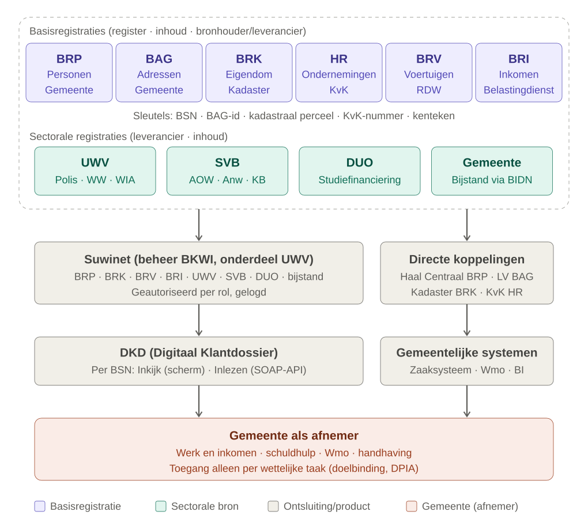

# Gegevenslandschap inwonerprofiel (gemeente)

Overzicht van de bronregisters, leveranciers, ontsluitingskanalen en onderlinge relaties die een rol spelen bij het opbouwen van een inwonerprofiel binnen de gemeente.



## Lagen in de plaat

| Laag | Wat | Voorbeelden |
|---|---|---|
| Bronregisters | Waar de gegevens authentiek worden vastgelegd | BRP, BAG, BRK, HR, BRV, BRI, UWV, SVB, DUO, gemeente |
| Ontsluiting | Hoe de gegevens bij de gemeente komen | Suwinet, directe koppelingen (Haal Centraal, LV BAG, Kadaster, KvK) |
| Product/view | Waar de gegevens samenkomen | DKD in Suwinet-Inkijk, gemeentelijke systemen |
| Afnemer | Wie de gegevens gebruikt | Gemeente: werk en inkomen, schuldhulp, Wmo, handhaving |

## Basisregistraties

| Register | Inhoud | Bronhouder | Landelijke voorziening | Sleutel | Kanaal |
|---|---|---|---|---|---|
| **BRP** – Basisregistratie Personen | Naam, geboorte, nationaliteit, adres, gezinssamenstelling | Gemeente | RvIG | BSN | Suwinet, Haal Centraal BRP / GBA-V |
| **BAG** – Basisregistratie Adressen en Gebouwen | Adressen, verblijfsobjecten, panden, gebruiksdoel, oppervlakte | Gemeente | Kadaster (LV BAG) | BAG-id (nummeraanduiding, verblijfsobject) | LV BAG / eigen BAG |
| **BRK** – Basisregistratie Kadaster | Eigendom, rechten, hypotheken, percelen | Kadaster | Kadaster | Kadastrale aanduiding | Suwinet, Kadaster-API's |
| **HR** – Handelsregister | Ondernemingen, rechtspersonen, functionarissen | KvK | KvK | KvK-nummer / RSIN | KvK-API's |
| **BRV** – Basisregistratie Voertuigen | Kentekens, voertuigbezit | RDW | RDW | Kenteken (gekoppeld aan BSN) | Suwinet |
| **BRI** – Basisregistratie Inkomen | Verzamelinkomen, toetsingsinkomen | Belastingdienst | Belastingdienst | BSN | Suwinet |

## Sectorale bronnen

| Leverancier | Inhoud | Kanaal |
|---|---|---|
| **UWV** | Polisadministratie (dienstverbanden, lonen), WW, WIA, Wajong, werkzoekendenregistratie | Suwinet |
| **SVB** | AOW, Anw, kinderbijslag, pgb | Suwinet |
| **DUO** | Studiefinanciering, inschrijving onderwijs, studieschuld | Suwinet |
| **Belastingdienst** | Toeslagen (naast de BRI) | Suwinet |
| **Gemeente** | Bijstand (Participatiewet) en re-integratie. Wmo en schuldhulp vallen buiten Suwinet. | Bijstandsgegevens via BIDN naar Suwinet, de rest in eigen systemen |

## Ontsluiting en product

- **Suwinet** (GeVS): de infrastructuur voor gegevensuitwisseling binnen de Suwi-keten (UWV, SVB, gemeenten). Gegevens worden alleen uitgewisseld als er een wettelijke grondslag en doelbinding is.
- **BKWI** (Bureau Keteninformatisering Werk en Inkomen): beheert Suwinet. Het is een apart organisatieonderdeel van UWV en werkt in opdracht van SZW.
- **BIDN** (Bureau Informatiediensten Nederland): regelt de gemeente als bron voor het DKD, dus het aanleveren van gemeentelijke (bijstands)gegevens aan Suwinet. Vermoedelijk is BIDN de voortzetting van het Inlichtingenbureau (vergelijk de dienst `IBVerwijsindex`). Dat is nog niet geverifieerd.
- **DKD** (Digitaal Klantdossier): een gemeenschappelijk, virtueel dossier per BSN, ontstaan vanuit de Wet eenmalige gegevensuitvraag. Het heeft twee vormen:
  - **Suwinet-Inkijk**: een webapplicatie (scherm) voor de medewerker.
  - **Suwinet-Inlezen**: SOAP-webservices waarmee je de gegevens machinaal in eigen systemen inleest.
- **Directe koppelingen**: gegevens die de gemeente buiten Suwinet om ophaalt, zoals Haal Centraal BRP, LV BAG, Kadaster en KvK. Ze landen in gemeentelijke systemen (zaaksysteem, Wmo-applicatie, BI-omgeving).

## Suwinet-Inlezen (de API van het DKD)

Er is geen REST-API voor "het DKD". Wel is er per bron een set SOAP 1.2-diensten.

| Bron | Webservice(s) |
|---|---|
| BRP | `BRPDossierPersoonGSD` |
| UWV | `UWVDossierInkomstenGSD`, `UWVDossierWerknemersverzekeringenGSD`, `UWVWbDossierPersoonGSD`, `UWVDossierAanvraagUitkeringStatusGSD`, `UWVDossierQuotumArbeidsbeperktenGSD` |
| SVB | `SVBDossierPersoonGSD` |
| DUO | `DUODossierPersoonGSD`, `DUODossierStudiefinancieringGSD` |
| Kadaster | `KadasterDossierGSD` |
| RDW | `RDWDossierGSD` |
| Gemeenten | `Bijstandsregelingen`, `GSDDossierReintegratie`, `IBVerwijsindex` |

Technische kenmerken:

- Toegang via een Suwinet-gateway met **mTLS** (client- en servercertificaat).
- Berichten worden ondertekend met **WS-Security**.
- De zoeksleutel is standaard het **BSN**.
- Aansluiting en autorisatie lopen via BKWI. Per dienst zijn een grondslag en doelbinding vereist.
- Voorbeeld van een afnemer: Open Forms, met de Suwinet-plugin voor prefill.

## Relaties tussen de bronnen

```
BRP (BSN) ──woonadres──▶ BAG (nummeraanduiding / verblijfsobject)
BAG (verblijfsobject) ──ligt op──▶ BRK (kadastraal perceel)
BRK (eigenaar) ──is──▶ BRP (BSN) of HR (KvK-nummer / RSIN)
BRV (kenteken) ──tenaamstelling──▶ BRP (BSN)
UWV / SVB / DUO / BRI ──per──▶ BSN
```

- **Wie**: BRP. Het BSN is het centrale koppelpunt.
- **Waar**: BAG.
- **Wat bezit iemand**: BRK en BRV.
- **Ondernemerschap**: HR.
- **Inkomen en voorzieningen**: BRI, UWV, SVB, DUO en de gemeente zelf.

## De gemeente heeft een dubbelrol

- **Bronhouder** van BRP en BAG, en van de eigen gegevens over bijstand, Wmo en schuldhulp.
- **Afnemer** van alle andere bronnen, via Suwinet en via directe koppelingen.

## Randvoorwaarden

- **Doelbinding**: gegevens raadplegen mag alleen voor een concrete wettelijke taak, bijvoorbeeld de Participatiewet. Een generiek "compleet profiel" is niet toegestaan.
- **Autorisatie per rol** in Suwinet. Elke raadpleging wordt per medewerker gelogd.
- **Profilering**: gegevens uit BRP, BAG, BRK en inkomensbronnen combineren valt al snel onder profilering. Lessen uit de SyRI-uitspraak (2020) en de toeslagenaffaire gelden hier. Er zijn een DPIA, een expliciete grondslag en dataminimalisatie nodig.
- **Ontwerpadvies**: ontwerp het profiel per proces of doel ("wat heeft de consulent bijstand nodig?") en niet als één totaalbeeld.

## Open punten

- Welke bronnen per gemeente via Suwinet-Inkijk beschikbaar zijn, hangt af van het autorisatieprofiel. Verifieer dit bij de Suwinet-beheerder.
- Of het Handelsregister in de lokale situatie via Suwinet of rechtstreeks wordt ontsloten.

## Bronnen

- [VNG – Wie mag Suwinet gebruiken (factsheet)](https://vng.nl/sites/default/files/factsheet-wie-mag-suwinet-gebruiken_20151207.pdf)
- [Sira Consulting – evaluatie informatiediensten BKWI/BIDN](https://zoek.officielebekendmakingen.nl/blg-1242999.pdf)
- [VNG – Werk en inkomen digitaal (Suwinet)](https://vng.nl/projecten/werk-en-inkomen-digitaal-suwinet)
- [Open Forms – Suwinet prefill](https://open-forms.readthedocs.io/en/3.5.7/configuration/prefill/suwinet.html)
- [BKWI – Suwinet-Inlezen](https://bkwi.nl/producten/suwinet-inlezen)
- [Kamerstuk 2010 – doorontwikkeling Suwinet naar DKD](https://berthub.eu/tkconv/getraw/2010D23296)
